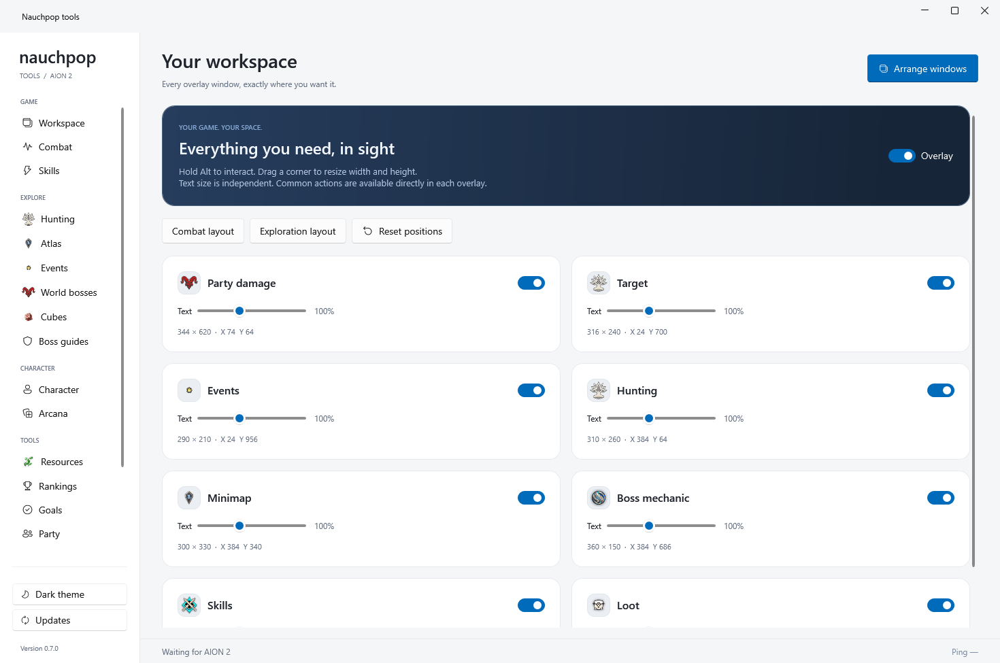
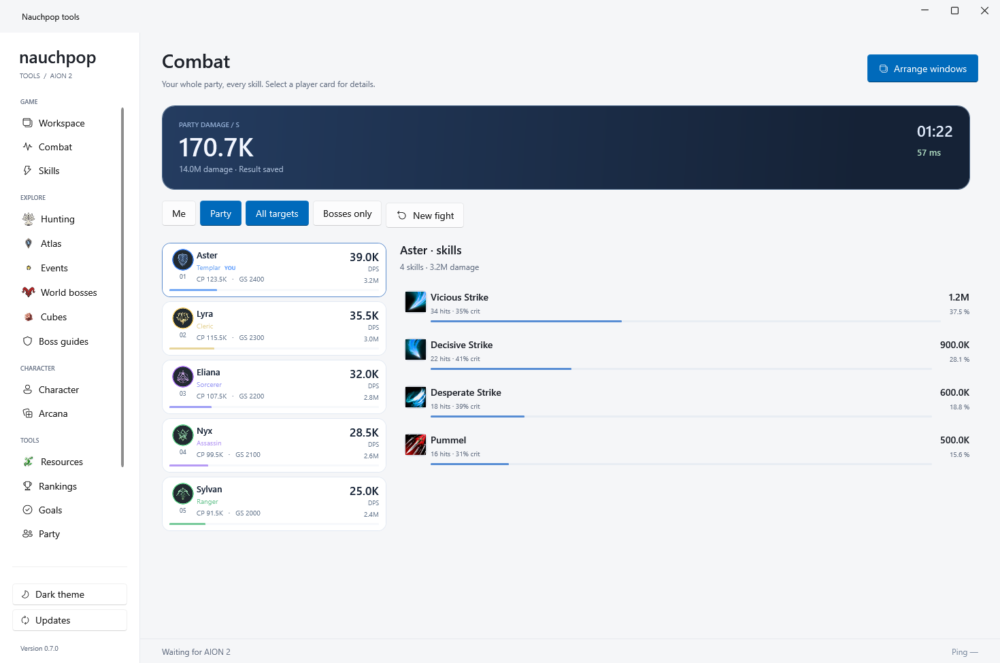
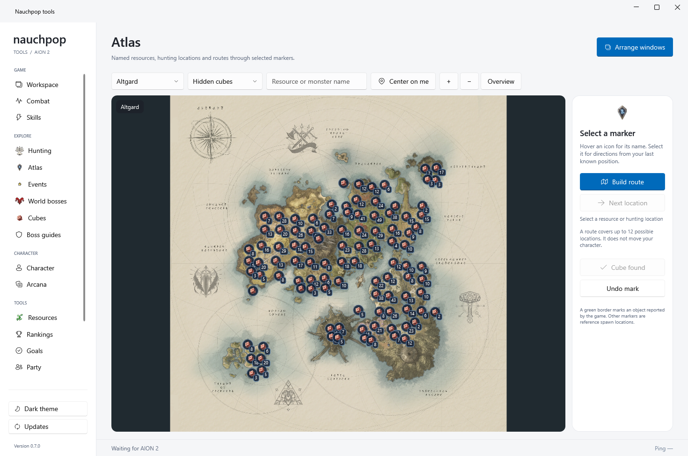
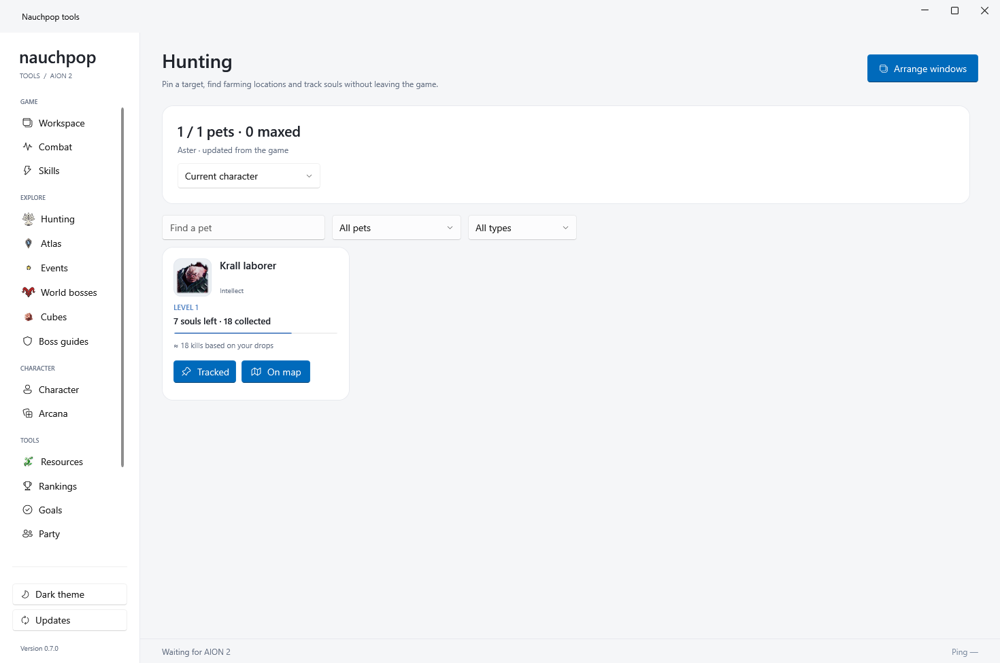
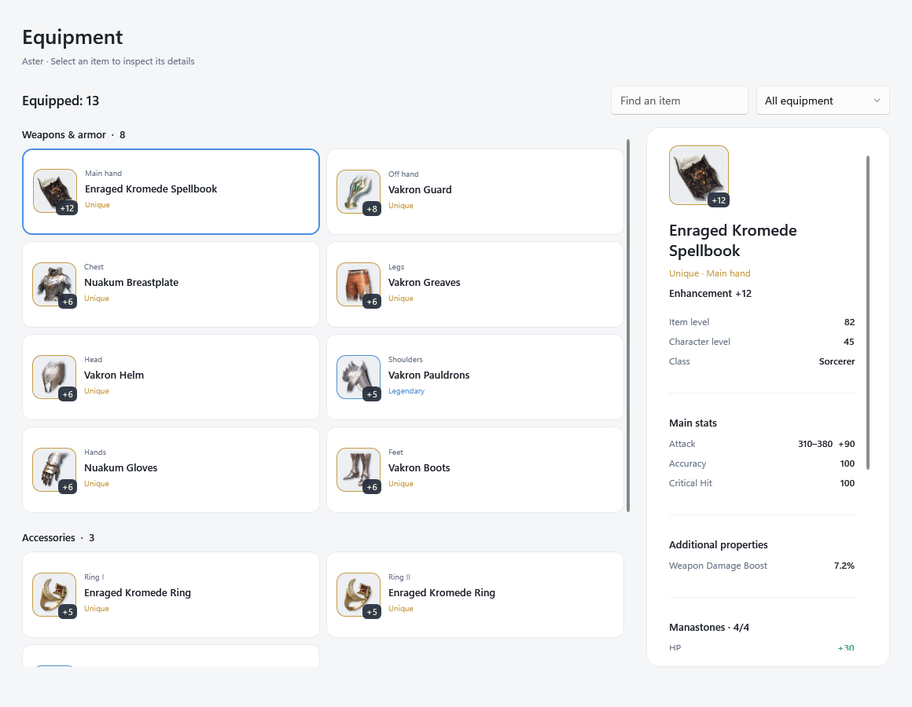

# Nauchpop tools for AION 2

A Windows companion that keeps combat, hunting, maps and event timers within reach.

**English** · [Русский](README.ru.md)

[Download for Windows x64](https://github.com/squortexxx/AION-2-Tools/releases/latest) · [Installation & controls](docs/guide.en.md) · [Changelog](CHANGELOG.md) · [Report an issue](https://github.com/squortexxx/AION-2-Tools/issues)

## Your tools, your layout

Eight independent overlays: party damage, target, hunting, minimap, events, boss instructions, skills and loot. Move each window, resize its width and height independently, adjust text size, and choose which panels stay on screen. Common actions live inside the overlays.

| Feature | What it does |
| --- | --- |
| Party DPS | Player cards with names, classes, damage, DPS, CP and GS when available. Switch between your damage and the party, all targets and bosses. Inspect skill damage and the last 30 fights. |
| Hunting & pets | Pin collection targets, see remaining souls and session drops, filter your collection, and jump to reference hunting locations. |
| Atlas & resources | Game maps with named resource icons, searchable markers, hidden cube locations, hunting spots and routes of up to 12 locations. |
| Nearby cube alerts | A visual alert, optional sound, distance and elevation when a cube is reported nearby and a fresh player position is available. |
| Events | Upcoming events, local start times, game icons and optional one-minute reminders. |
| Skills & boss guides | Learned skills, active cooldowns and observed casts. Associate a skill ID with your own visual or spoken instruction. |
| Character & Arcana | Public-profile equipment, combat power, gear score, Arcana stats and an upgrade comparison planner. |
| More session tools | Loot feed, character resources, rankings, party finder information and personal goals as data becomes available. |
| Languages & updates | English by default, Russian available in Settings. In-app update checks, verified downloads and installation when you choose. |

## See the details

### Combat that stays readable

Player cards stay in a stable order while damage updates. Select a card to inspect its skills. The target panel is separate and keeps the last target after defeat.

### A clearer route through the world

Resources use game icons and names. Filter the atlas, choose a location and build a route. Hunting targets connect your collection progress to reference spawn locations.

### Equipment you can actually inspect

Browse game-icon cards with real item names, rarity, enhancement and slot labels. Search or filter your equipment, then select an item for stats, manastones, granted skills and acquisition sources in a separate inspector. Manual loading refreshes the public-profile data.

*Screenshots are rendered by the application. Combat and hunting previews use illustrative data; they are not live gameplay measurements.*

## Install in a few minutes

1. Download `Nauchpop-tools-0.7.2-setup.exe` from [Releases](https://github.com/squortexxx/AION-2-Tools/releases/latest).
2. Run Setup and choose English or Russian. Windows will request administrator permission for installation.
3. If Npcap is missing, Setup downloads a pinned, checksum-verified installer from **npcap.com**. Complete the official Npcap wizard; Nauchpop setup then continues. Npcap is not bundled.
4. Launch Nauchpop tools, then enter AION 2. If you are already in the game, produce some game activity; reconnecting your character can provide missing initial data.
5. Open **Settings** to choose your character name, region and server. This helps match your own damage and load public-profile CP/GS.
6. Open **Workspace → Arrange windows**, or press **Ctrl + Alt + M**. Position your panels and choose **Done**. Hold **Alt** for normal interaction with overlays.

Windows 10/11 x64 is required. The .NET runtime is included. Borderless/windowed game mode is recommended for overlays. No game-account login or GitHub account is required to use the app.

For a ZIP build, extract the **entire folder** before launching `NauchpopTools.Next.exe`. Install Npcap separately from its [official website](https://npcap.com/) if needed.

## How it works

Npcap observes the local AION 2 connection. A bounded decoder turns received game data into combat, target, collection and world-object state. The app uses local catalogs for maps and game art, and public NCSOFT profiles to supplement character stats when enabled.

The app does not require your game password or session cookies. It does not inject code into the game or automate character movement. Settings, collections and fight history are stored locally in `%LOCALAPPDATA%\NauchpopTools.Next`.

Updates are hosted in this repository's **GitHub Releases**. The app verifies an RSA-PSS signature with a pinned public key, then verifies the installer's size and SHA-256 checksum. It checks automatically after launch and every 12 hours; downloading and installing require your action. Settings and collection progress survive updates.

## Know what the data means

- Live information depends on the packets your client has received. Open the relevant in-game collection, skills, ranking or party window to populate missing data.
- CP/GS require a matching, accessible public profile and may be cached for up to 15 minutes. Unknown values remain unknown.
- Ping comes from game responses and is hidden when stale.
- Atlas spawn points are references, not proof that an object is currently present. Static markers do not trigger nearby-cube alerts.
- Boss instructions are configured per skill ID. A complete automatic guide for every encounter is not included.
- Protocol compatibility can change after game updates. See the [troubleshooting guide](docs/guide.en.md#troubleshooting) before reporting missing data.

## Project information

This repository contains the product page, documentation, screenshots and release downloads. Application source is maintained privately. Third-party notices ship in the application's `licenses` folder; see [component notes](THIRD_PARTY.md).

Nauchpop tools is an independent community project and is not affiliated with NCSOFT. See [privacy and update security](docs/security.en.md) for data sources, storage and verification details.
