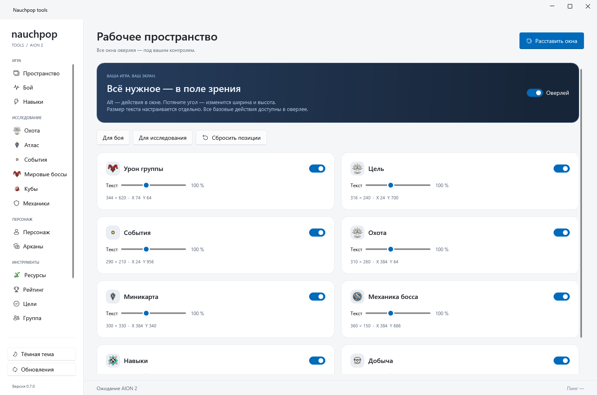
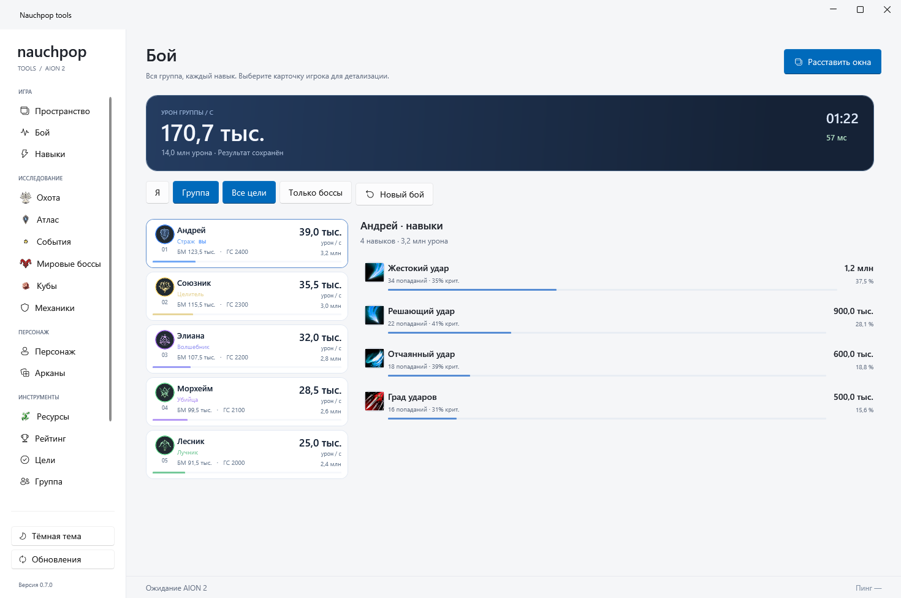
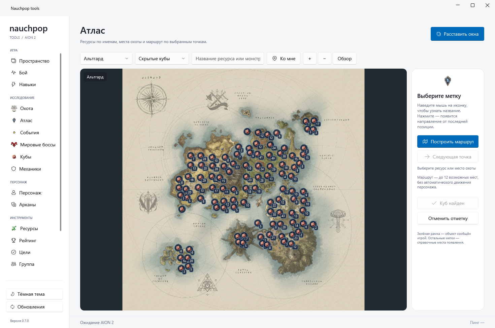
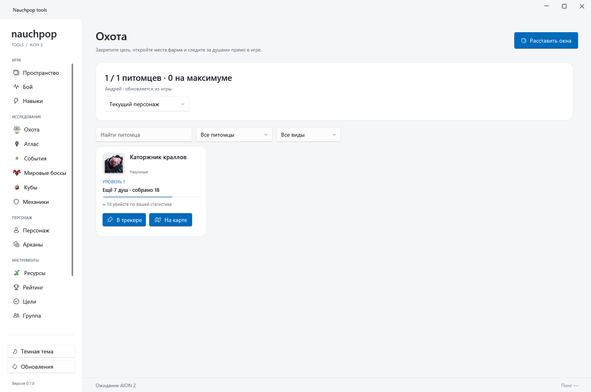
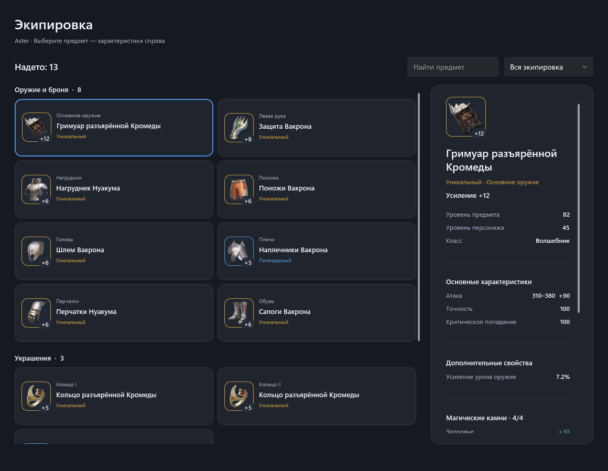

# Nauchpop tools для AION 2

Компаньон для Windows: бой, охота, карты и события всегда под рукой.

[English](README.md) · **Русский**

[Скачать для Windows x64](https://github.com/squortexxx/AION-2-Tools/releases/latest) · [Установка и управление](docs/guide.ru.md) · [История изменений](CHANGELOG.ru.md) · [Сообщить об ошибке](https://github.com/squortexxx/AION-2-Tools/issues)

## Ваши инструменты. Ваше расположение.

Восемь независимых оверлеев: урон группы, цель, охота, миникарта, события, механики босса, навыки и добыча. Каждое окно можно перемещать, менять его ширину и высоту независимо, настраивать размер текста и скрывать. Базовые действия доступны прямо в оверлеях.

| Функция | Что умеет |
| --- | --- |
| ДПС группы | Карточки игроков с именем, классом, уроном, ДПС, БМ и ГС при наличии данных. Переключение между своим уроном и группой, всеми целями и боссами. Детализация навыков и последние 30 боёв. |
| Охота и питомцы | Закрепление целей коллекции, оставшиеся души, добыча за сеанс, фильтры и переход к справочным местам охоты. |
| Атлас и ресурсы | Игровые карты с названиями и иконками ресурсов, поиск меток, скрытые кубы, места охоты и маршруты до 12 точек. |
| Алерты о кубах | Визуальное уведомление, дополнительный звук, расстояние и высота при сообщении о кубе рядом и свежей позиции персонажа. |
| События | Ближайшие события, начало в местном времени, игровые иконки и напоминания за минуту. |
| Навыки и механики | Изученные навыки, активные перезарядки и замеченные касты. К ID навыка можно привязать свою текстовую или голосовую подсказку. |
| Персонаж и арканы | Экипировка из публичного профиля, БМ, ГС, характеристики аркан и сравнение уровней усиления. |
| Инструменты сеанса | Лента добычи, ресурсы персонажа, рейтинг, поиск группы и личные цели по мере получения данных. |
| Языки и обновления | Английский по умолчанию, русский в настройках. Проверка новой версии, проверяемая загрузка и установка по вашей команде. |

## Подробнее об интерфейсе

### Читаемый бой

Карточки сохраняют порядок при обновлении урона. Нажмите карточку для просмотра навыков. Цель вынесена в отдельную панель и остаётся после победы.

### Понятный маршрут по миру

Ресурсы отмечены игровыми иконками и названиями. Выберите фильтр, точку и постройте маршрут. Охота связывает прогресс коллекции со справочными местами появления мобов.

### Экипировка с подробностями

Карточки с игровыми иконками, настоящими названиями, редкостью, усилением и слотами. Найдите вещь или выберите категорию; нажмите предмет для характеристик, магических камней, навыков и источников получения в отдельной панели. Ручная загрузка обновляет данные публичного профиля.

*Скриншоты сделаны самим приложением. Для демонстрации боя и охоты используются примерные данные; это не измерения живого игрового сеанса.*

## Установка за несколько минут

1. Скачайте `Nauchpop-tools-0.7.2-setup.exe` из [Releases](https://github.com/squortexxx/AION-2-Tools/releases/latest).
2. Запустите Setup и выберите английский или русский язык мастера. Windows запросит права администратора для установки.
3. Если Npcap отсутствует, Setup загрузит закреплённую версию с **npcap.com** и проверит контрольную сумму. Завершите официальный мастер Npcap; затем установка Nauchpop продолжится. Драйвер не встроен в пакет.
4. Запустите Nauchpop tools и войдите в AION 2. Если игра уже открыта, выполните игровые действия; повторный вход персонажем может помочь получить недостающие начальные данные.
5. В **Settings** выберите имя, регион и сервер. Это помогает определить ваш урон и дополнить БМ/ГС из публичного профиля. В начале страницы выберите **Русский** — приложение переключится сразу.
6. Откройте **Пространство → Расставить окна** или нажмите **Ctrl + Alt + M**. Расположите панели и нажмите **Готово**. Для обычного взаимодействия с оверлеями удерживайте **Alt**.

Нужна Windows 10/11 x64. Среда .NET включена. Для оверлеев рекомендуется оконный режим или окно без рамки. Вход в игровой аккаунт и аккаунт GitHub в приложении не требуется.

При использовании ZIP распакуйте **всю папку**, затем запустите `NauchpopTools.Next.exe`. При необходимости установите Npcap отдельно с [официального сайта](https://npcap.com/).

## Как это работает

Npcap наблюдает за локальным соединением AION 2. Декодер с ограниченными очередями превращает полученные игровые данные в состояние боя, цели, коллекции и объектов мира. Карты и игровые изображения берутся из локальных каталогов, дополнительные характеристики — из публичных профилей NCSOFT, если это включено.

Программа не требует пароль от игры или cookies сеанса, не внедряет код в игру и не двигает персонажа автоматически. Настройки, коллекции и история боёв сохраняются в `%LOCALAPPDATA%\NauchpopTools.Next`.

Обновления размещаются в **GitHub Releases** этого репозитория. Приложение проверяет подпись RSA-PSS закреплённым открытым ключом, затем размер и SHA-256 установщика. Проверка выполняется после запуска и раз в 12 часов; скачивание и установка начинаются по вашей кнопке. Настройки и коллекция сохраняются.

## Что означают данные

- Живая информация зависит от пакетов, которые получил клиент. Для заполнения откройте соответствующие окна коллекции, навыков, рейтинга или группы в игре.
- БМ/ГС требуют доступного публичного профиля с совпадающими именем и сервером; кэш — до 15 минут. Неизвестные значения не подменяются.
- Пинг берётся из игровых ответов и скрывается при устаревании.
- Точки атласа — справочные места, а не подтверждение текущего появления. Статические метки не вызывают алерты о кубах.
- Подсказки босса настраиваются по ID навыка. Готовая автоматическая инструкция для каждого босса не включена.
- После обновлений игры совместимость протокола может меняться. При отсутствии данных начните с [решения проблем](docs/guide.ru.md#решение-проблем).

## О проекте

В этом репозитории находятся страница продукта, документация, скриншоты и выпуски. Исходный код приложения хранится отдельно и остаётся закрытым. Лицензии компонентов входят в папку `licenses`; см. [сведения о компонентах](THIRD_PARTY.md).

Nauchpop tools — независимый проект сообщества, не связанный с NCSOFT. Подробнее об источниках данных и проверке файлов — в разделе [конфиденциальность и обновления](docs/security.ru.md).
